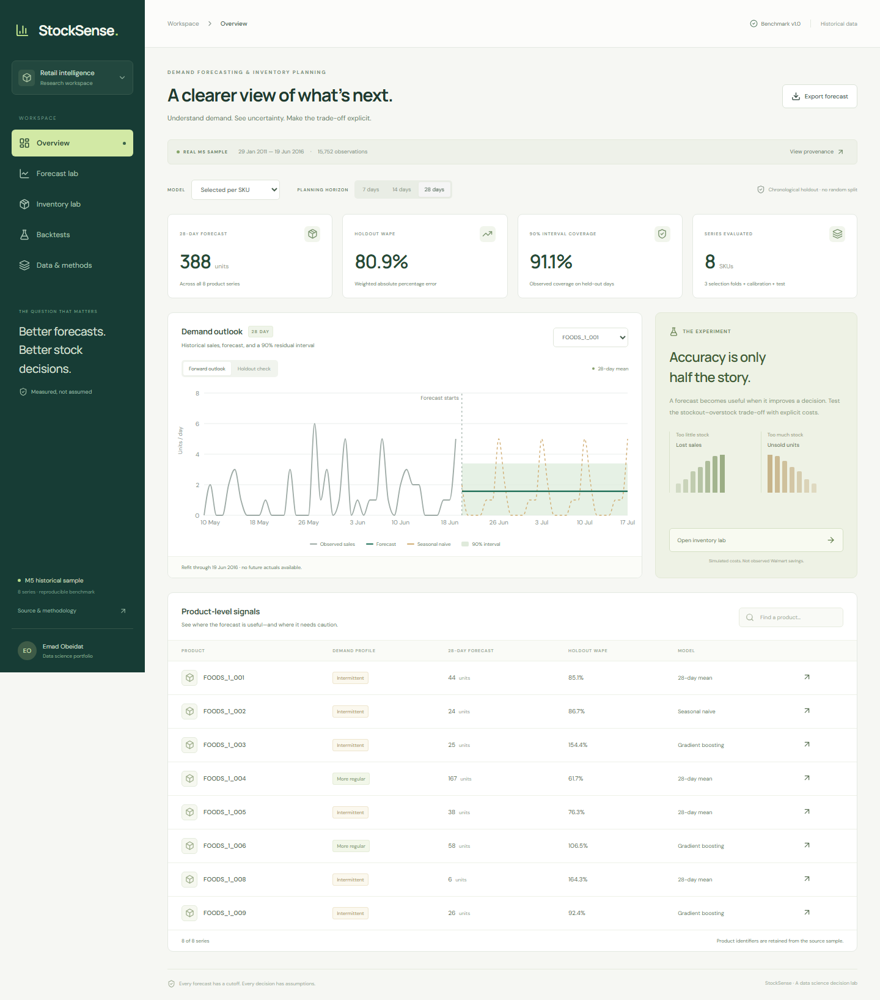

# StockSense

[Methodology](docs/methodology.md) · [Decision memo](docs/decision-memo.md)

**A demand forecast is useful when it improves a decision.** StockSense is a reproducible data-science project connecting retail forecasting, uncertainty and inventory economics—with a working interactive research dashboard.



## What you can do

- Explore eight real M5 product series, with explicit historical dates and source fingerprints.
- Compare seasonal naive, a trailing-mean baseline, gradient boosting, and a strategy selected separately for each SKU.
- Switch between a forward outlook and an untouched historical holdout; inspect approximate 90% residual intervals.
- Compare rolling-origin errors, coverage and bias; inspect the SQLite data-quality audit.
- Simulate a single-period stock decision with assumed overage/shortage costs and starting stock.
- Compare expected bootstrap cost with retrospective realized cost, and export forecasts or benchmark evidence.

The UI reads **measured Python outputs**, not fabricated dashboard numbers. Model training is a reproducible CLI workflow; browser filters do not retrain models.

## The result that makes this a data-science project

On the fixed 28-day holdout, selected-per-SKU WAPE is **80.88%**, versus **105.76%** for seasonal naive. Global gradient boosting scores **78.19%**, so model selection did not outperform every comparator. Sparse, low-volume demand produces high relative errors; a lower WAPE here does not imply production readiness.

For `FOODS_1_004`, the lower-error boosting forecast produced **higher simulated inventory cost** than seasonal naive under the documented default assumptions. Read the [one-page decision memo](docs/decision-memo.md) for the counterexample, recommendation and limits.

## Run the dashboard

Node.js 20.18+ or 22 and Python 3.12 are the tested local runtimes.

```bash
npm ci
npm run dev
```

Open **http://localhost:5180**. The committed `public/benchmark.json` lets you explore the completed experiment without downloading data or running Python.

## Reproduce the science

```bash
python -m venv .venv
# Linux/macOS: source .venv/bin/activate
# Windows: .venv\Scripts\Activate.ps1
pip install -r requirements.txt
python -m stocksense.fetch_data
python -m stocksense.pipeline
python -m pytest -q tests/test_science.py
```

The pipeline validates data, builds an ignored SQLite database, runs three selection folds plus a calibration fold and final test, then writes the dashboard artifact and [machine-readable metrics](docs/metrics.json). To use a different CSV with the same schema, provide `--source`; update its provenance manifest intentionally rather than bypassing the fingerprint check.

```bash
npm run build
npx playwright install chromium
# With the local frontend running:
npm test
```

## Data and scope

The source is [Nixtla's public M5 sample](https://github.com/Nixtla/transfer-learning-time-series/blob/45e749a7e6a513dd843dbdf82181b1e27bbaf232/datasets/m5_sales_exog_small.csv), derived from the [Walmart M5 forecasting competition](https://www.kaggle.com/competitions/m5-forecasting-accuracy). It contains 15,752 observations: eight food-product series from 2011–2016. The sample does not supply product descriptions or store identities. It is not the complete M5 hierarchy, and no official competition score is claimed.

Sales are treated as a demand proxy. No actual inventory availability, stockout flags, lead times or operating cost measurements are present. The app's cost results are explicitly hypothetical, and displayed forecasts are based on historical cutoffs rather than live 2026 operations.

## Repository map

```text
stocksense/       validation, forecasting, calibration, inventory and pipeline
web/              React + TypeScript dashboard, charts and simulator
data/source.json  pinned data source and fingerprint
public/           reproducible dashboard benchmark artifact
tests/            leakage, metric, calibration, policy and browser regressions
docs/             measured metrics, methodology and decision memo
```

[Methodology and leakage controls](docs/methodology.md) explain the recursive forecast design, chronological split, small-sample uncertainty and decision assumptions.

## License

Project code: [MIT](LICENSE). Original data remain subject to their publishers' terms; the project code license does not relicense Walmart/M5 or Nixtla data. Raw source data are fetched separately and excluded from Git. Small derived evaluation outputs carry their original source attribution.

